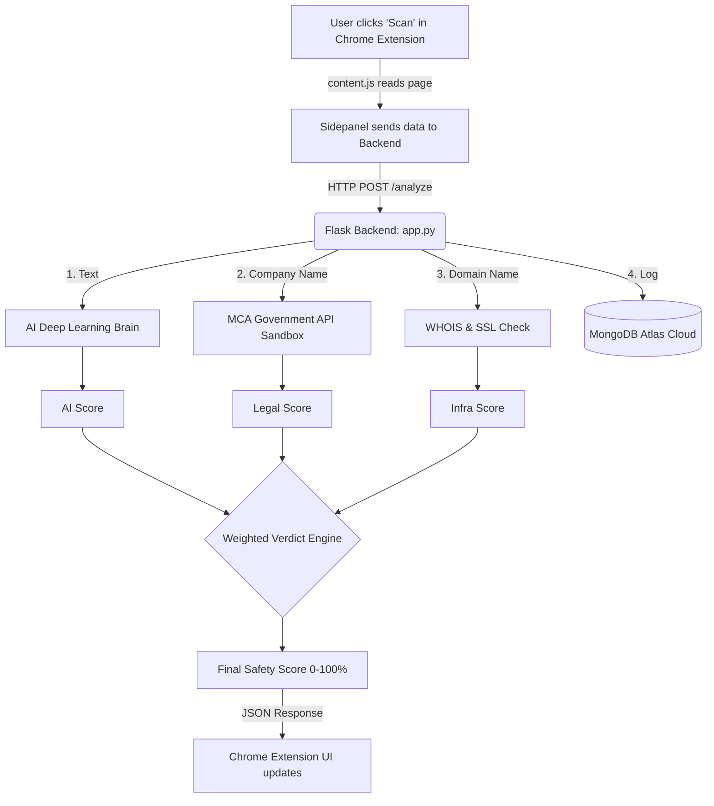

# Career Authenticity Engine
**Complete Project Documentation & Architecture Guide**

---

## 1. Introduction: What is this project?
The **Career Authenticity Engine** is a professional-grade cybersecurity tool designed to protect job seekers from employment scams, phishing links, and fake companies. 

It operates as a **Google Chrome Extension** that sits quietly in your browser. When you view a job posting on sites like LinkedIn, Indeed, or Nykaa, you can open the extension's side panel and click "Scan". The extension reads the job data and sends it to your **Python Backend**. The backend then acts as a detective—running the job through an Artificial Neural Network (AI) and cross-referencing it with government databases to generate a final "Safety Score".

---

## 2. The Core Pipeline: How it all connects
Here is the simplest way to understand the flow of data from the moment you click "Scan" to the moment the score appears.

### Step-by-Step Flow:
1. **Frontend Extraction (`content.js`)**: The Javascript looks at the webpage's HTML and finds the Job Title, Company Name, and Job Description. It "peels" away the website's outer layers to find the true employer.
2. **Transmission (`sidepanel.js`)**: The frontend sends this data to the Python server via an HTTP POST request to `http://127.0.0.1:5000/analyze`.
3. **Verification (`app.py` & `verifiers.py`)**: The server receives the data and runs it through multiple independent tests (AI, Government, SSL).
4. **The Verdict**: The server calculates a weighted score and sends the final JSON report back to the Chrome Extension to be displayed beautifully to the user.

---

## 3. The Artificial Intelligence (NLP & ML)
To detect scams, the backend uses **Natural Language Processing (NLP)** and **Machine Learning (ML)**.

### A. NLP: How the computer reads (TF-IDF Vectorization)
Computers cannot read English. To feed the job description into the AI, we use a `TfidfVectorizer`.
* **TF (Term Frequency)**: How often does a suspicious word (like "Urgent", "WhatsApp", "Fee") appear in the job?
* **IDF (Inverse Document Frequency)**: How rare is this word in normal jobs? 
* **The Result**: The Vectorizer turns the entire text into a giant array (matrix) of numbers, highlighting the mathematically suspicious words.

### B. Machine Learning: The Artificial Neural Network (ANN)
We upgraded from basic math to Deep Learning using `scikit-learn`'s **Multi-Layer Perceptron (MLPClassifier)**.
* **Input Layer**: Takes in the mathematical array of words from the Vectorizer.
* **Hidden Layers**: We created 3 hidden layers (128 neurons -> 64 neurons -> 32 neurons). These act like a human brain, finding deep, non-obvious patterns (e.g., recognizing that "Urgent" + "Work from home" + "Data entry" combined is a massive red flag).
* **Output Layer**: It compresses all that thought into a single probability (0.0 to 1.0) representing how likely the job is a scam.

---

## 4. The Verification Layers (External APIs)
The AI is smart, but it's not enough. We verify the actual existence of the company using the following tools:

### 1. The Sandbox API (MCA Registry)
* **What it does**: Connects to the Indian Government's Ministry of Corporate Affairs (MCA).
* **How it works**: The `legal_engine.py` script cleans the company name (e.g., changing "Google - Hiring" to just "Google") and asks the Sandbox API for the Corporate Identification Number (CIN).
* **Why it matters**: If a company is not registered with the government, it is highly suspicious.

### 2. WHOIS XML API (Domain Age)
* **What it does**: Checks how old the company's website is.
* **How it works**: Uses the `WHOIS_KEY` to ask the global domain registry when the website was created.
* **Why it matters**: Scammers buy throwaway websites (e.g., `nykaacareers-apply.com`) that are only 3 days old. Real companies have websites that are years old.

### 3. Apify API (Social Proof)
* **What it does**: Scrapes LinkedIn to find the company's official profile.
* **Why it matters**: A real company will have a LinkedIn page with actual employees. Scammers usually do not.

### 4. MongoDB Atlas (Global Safety Network)
* **What it does**: A cloud database that acts as our memory and global blacklist.
* **How it works**: We connect to it using a secure `MONGO_URI`. Because Windows sometimes struggles with secure connections, we use a library called `certifi` to force the secure SSL handshake.
* **Why it matters**: It logs every scan. If a URL gets flagged as a scam by multiple people, MongoDB remembers it and instantly blocks it for all future users.

---

## 5. Project File Structure
Here is where everything lives in your folder:

**`/extension` (The Frontend User Interface)**
* `manifest.json`: The ID card for the Chrome extension.
* `content.js`: The scraper that reads the job websites.
* `sidepanel.html` & `style.css`: The beautiful UI (built with CSS variables for Light/Dark mode).
* `sidepanel.js`: The logic that clicks the button, talks to Python, and draws the results.

**`/backend` (The Engine Room)**
* `app.py`: The main Flask server. It receives data, runs the tests, and calculates the final math.
* `verifiers.py`: Contains the code for checking SSL, Domain Age, and Dead links.
* `legal_engine.py`: Contains the code for the MCA Sandbox API check.
* `train_ann.py` & `generate_dataset.py`: The scripts used to create the AI brain.
* `career_auth_ann.pkl` & `vectorizer.pkl`: The actual "saved memory" of the trained AI.
* `.env`: The secret vault holding your API keys.

---

## 6. The Verdict Math (Theoretical Aspect)
Why is the final score so accurate? Because it uses a **Weighted Multi-Layered Approach**. 
No single test can fail a job (to prevent false alarms).

The final accuracy formula is:
**(Legal MCA Check × 40%) + (AI Analysis × 30%) + (Infrastructure SSL/Domain × 30%)**

* If a startup has a brand-new website (Low Infra score) but is legally registered (High Legal score) and writes professionally (High AI score), it will still pass as "Medium-Safe".
* If a scammer writes a beautiful job description (High AI score) but has no government registry (0 Legal score) and a 2-day old website (Low Infra score), they will fail catastrophically. 

This multi-layered defense makes it practically impossible for a scammer to trick the extension!
